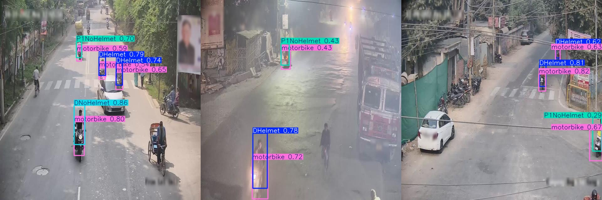
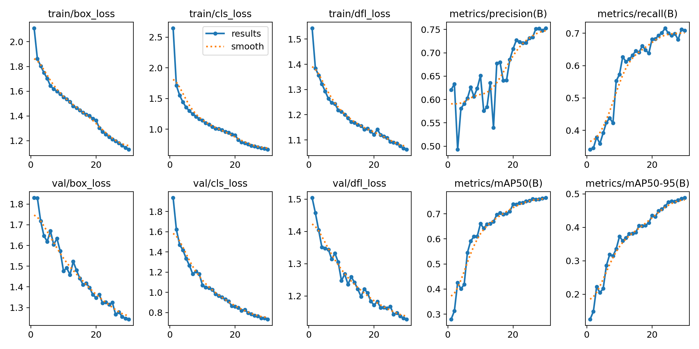
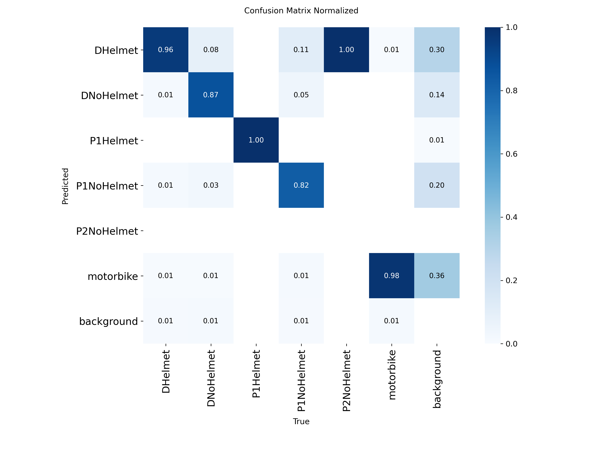
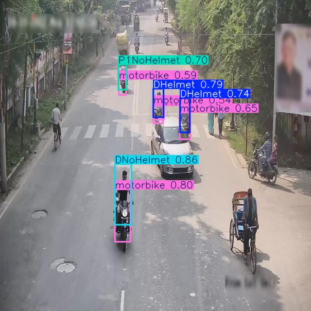
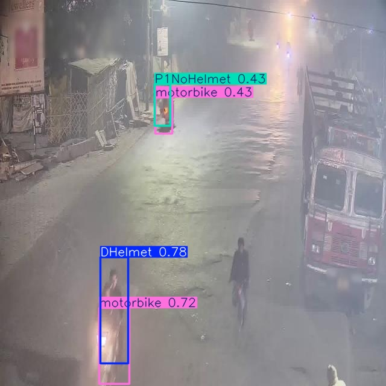
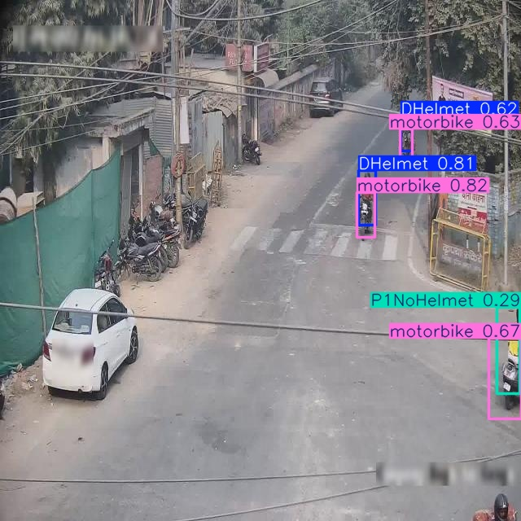
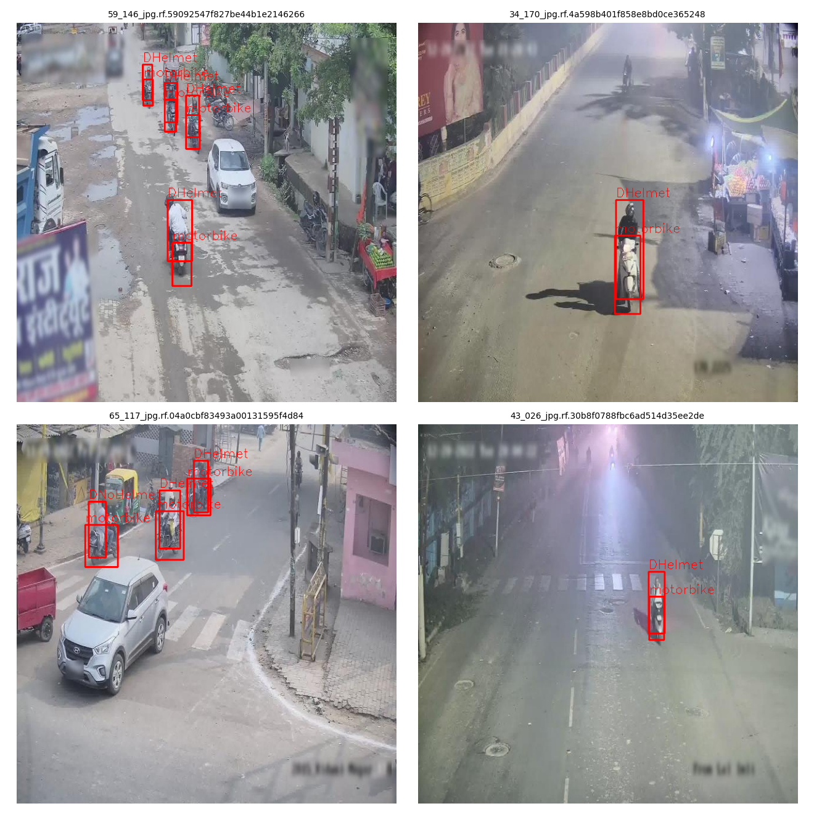

# Detecção de capacete em motociclistas com YOLOv8



Detector de objetos que identifica **motos, condutores e passageiros com e sem capacete** em imagens de câmeras de rua. O modelo foi treinado com **YOLOv8n** (Ultralytics), usando transfer learning a partir dos pesos pré-treinados no COCO.

Projeto desenvolvido na pós-graduação em **Ciência de Dados e Business Intelligence (UNICAMP)**, disciplina do Prof. Francisco Fambrini.

## Resultados

Avaliação no conjunto de validação: 967 imagens e 4.107 objetos anotados. O modelo usado é o `best.pt`.

| Classe | Objetos na validação | Precisão | Recall | mAP50 | mAP50-95 |
|---|---:|---:|---:|---:|---:|
| motorbike | 1.949 | 0,903 | 0,887 | 0,931 | 0,608 |
| DHelmet | 1.372 | 0,868 | 0,866 | 0,921 | 0,602 |
| DNoHelmet | 473 | 0,932 | 0,784 | 0,908 | 0,601 |
| P1NoHelmet | 302 | 0,897 | 0,699 | 0,829 | 0,516 |
| P1Helmet | 10 | 0,940 | 1,000 | 0,995 | 0,608 |
| P2NoHelmet | 1 | 0,000 | 0,000 | 0,000 | 0,000 |
| **Todas (média)** | **4.107** | **0,757** | **0,706** | **0,764** | **0,489** |

**Como ler esses números:**

- **O mAP50 geral (0,764) é puxado para baixo por uma única classe.** A `P2NoHelmet` tem **nenhum exemplo no treino** e apenas 1 na validação, então o modelo nunca teve como aprendê-la.
- **Nas 4 classes com volume real de dados**, o mAP50 médio é **0,897** e o mAP50-95 é **0,582**. As 4 classes são motorbike, DHelmet, DNoHelmet e P1NoHelmet.
- **A `P1Helmet` parece perfeita (mAP50 de 0,995), mas isso vem de só 10 objetos na validação.** Não é uma estimativa confiável.
- **O ponto fraco real é o recall de quem está sem capacete.** O modelo deixa passar cerca de 22% dos condutores e 30% dos passageiros sem capacete. Os objetos são pequenos e distantes da câmera, e essas classes têm menos exemplos que as de capacete.

As perdas de treino e validação caem de forma consistente, e o mAP50 se estabiliza nas últimas épocas.





### Exemplos de inferência (imagens de teste, confiança ≥ 0,25)

| | | |
|---|---|---|
|  |  |  |

## Dataset

- **Fonte:** [helmet-detection — Roboflow Universe](https://universe.roboflow.com/cvproject-soeqs/helmet-detection-swgr3)
- **Licença:** CC BY 4.0
- **Tamanho:** 4.871 imagens, divididas em 3.414 de treino, 967 de validação e 490 de teste.
- **Classes (6):** `motorbike`, `DHelmet`, `DNoHelmet`, `P1Helmet`, `P1NoHelmet` e `P2NoHelmet`. Pela nomenclatura, D é o condutor e P1/P2 são os passageiros.
- **Formato:** exportado do Roboflow em formato YOLOv8. Cada imagem tem um `.txt` em que cada linha traz `classe x_centro y_centro largura altura`, com valores normalizados entre 0 e 1.



## Treinamento

| Parâmetro | Valor |
|---|---|
| Modelo base | `yolov8n.pt` (nano, pré-treinado no COCO) |
| Épocas | 30 |
| Tamanho de imagem | 640 |
| Batch | 16 |
| Ambiente | Google Colab, GPU T4 |

O notebook [`treino.ipynb`](treino.ipynb) cobre o fluxo inteiro, com as saídas da execução:

1. Download do dataset pela API do Roboflow (a chave é digitada na hora e não fica salva no código).
2. Inspeção dos dados.
3. Ajuste do `data.yaml`.
4. Treino e avaliação.
5. Inferência.
6. Geração automática do relatório.

## Como usar o modelo

```bash
pip install -r requirements.txt
python uso.py minha_imagem.jpg outra_imagem.jpg
```

O script carrega o `best.pt`, detecta os objetos e mostra no terminal a classe e a confiança de cada um. As imagens com as caixas desenhadas são salvas em `runs/detect/predict/`.

## Próximos passos

- Juntar `P1Helmet` e `P2NoHelmet` em classes mais genéricas (`Helmet` / `NoHelmet`) ou conseguir mais exemplos delas.
- Treinar por mais épocas e testar um modelo maior (`yolov8s`), para melhorar o recall em objetos pequenos.

## Estrutura

```
├── treino.ipynb        # treino completo (Colab), com saídas
├── uso.py              # script de inferência
├── best.pt             # modelo treinado
├── requirements.txt
├── preview.png
└── imagens/            # gráficos, matriz de confusão e inferências
```

---

**Walter Cordeiro Guilhermino** · [GitHub](https://github.com/WalterCordeiroGuilhermino)
